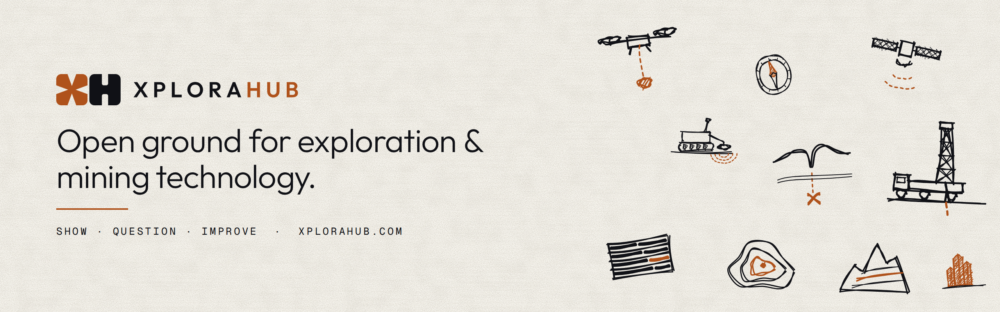
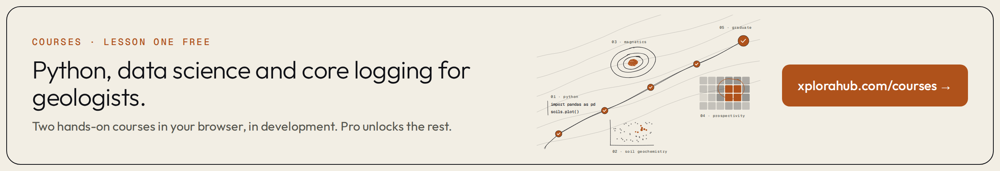
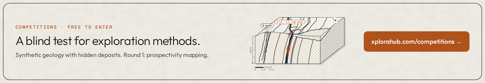
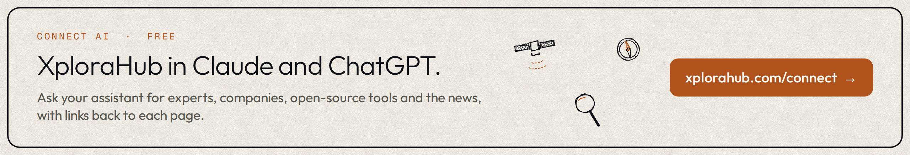

**[XploraHub](https://xplorahub.com)** is an online community for mineral exploration and mining technology. Members show the tools they build and the field tests they run, and geologists, geophysicists, engineers and data scientists question them in the open.

### How it works

| Show it | Question it | Improve it |
|---|---|---|
| Post a tool, model, dataset or field test, and say what it was tested on. | People who know the ground ask how it was tested and where it fails. | The author marks the comments that helped. Those hits build each member's expert profile. |

### Explore

| | |
|---|---|
| [**The feed**](https://xplorahub.com/feed) | New tools, field tests and questions, ranked by members' votes |
| [**Course**](https://xplorahub.com/courses) | Python, data science, machine learning and AI for geologists, in six interactive modules from 3D drill holes to core logging (in development) |
| [**Competitions**](https://xplorahub.com/competitions) | A blind test for exploration methods on synthetic geology, starting with prospectivity mapping (in development) |
| [**Experts**](https://xplorahub.com/directory) | Members' expert profiles, built from hits and endorsements |
| [**Technology companies**](https://xplorahub.com/directory/organisations) | The companies building exploration and mining technology |
| [**Exploration methods**](https://xplorahub.com/methods) | Practical guides to geophysics, drilling, geostatistics and other methods |
| [**Guides**](https://xplorahub.com/guides) | Deposit types and how each is explored, assay QA/QC, reporting and careers |
| [**Products**](https://xplorahub.com/products) | Products from the listed companies, with a Product of the week chosen by members' votes |
| [**Open source**](https://xplorahub.com/open-source) | Open-source software and public geoscience data, sorted by method |
| [**Watch**](https://xplorahub.com/watch) | Talks, case studies, tutorials and field films chosen for substance, with no investor promos |
| [**Field Notes**](https://xplorahub.com/fieldnotes) | Our own articles and interviews |
| [**News**](https://xplorahub.com/news) | Exploration and mining technology news |
| [**Events**](https://xplorahub.com/events) | Conferences, field days and webinars in exploration and mining technology |
| [**Newsletters**](https://xplorahub.com/newsletters) | Midweek, Intel and Recap, by email |
| [**Connect AI**](https://xplorahub.com/connect) | XploraHub in Claude, ChatGPT or Claude Code: ask about experts, companies and tools, with links back |

### A few words we use

- **Votes** rank posts. They only go up; there are no downvotes.
- **Hits** are comments the author marks because they improved the post or taught them something. Hits are earned, not given to yourself.
- **Endorsements** are members vouching for each other's expertise.
- **Verified** companies have been checked by a person: the company exists and builds or uses technology for exploration or mining. It is not a test of their products.
- **Official** marks a video from a listed company's own channel.

### Open source

| Repository | What it is |
|---|---|
| [**Awesome mineral exploration**](https://github.com/XploraHub/awesome-mineral-exploration) | Open-source software for exploration, sorted by method, from geophysical inversion to prospectivity mapping |
| [**Awesome mining**](https://github.com/XploraHub/awesome-mining) | Open-source software for working mines, from mine planning and geotechnics to processing, tailings and closure |
| [**Geoscience data portals**](https://github.com/XploraHub/geoscience-data-portals) | Government geoscience data portals: what each holds, how to get the data, what licence applies and what to watch out for |

The code that builds the competitions' synthetic belts and scores the entries will be published here too, so anyone can check it.

Built an open-source tool for exploration or mining? Add it to the matching list with a pull request, or [show it on XploraHub](https://xplorahub.com/submit). Spotted a portal we've missed? [Open an issue](https://github.com/XploraHub/geoscience-data-portals/issues/new/choose).

### Follow

[LinkedIn](https://www.linkedin.com/company/xplorahub) · [X](https://x.com/xplorahubtech) · [YouTube](https://www.youtube.com/@xplorahubtech)
