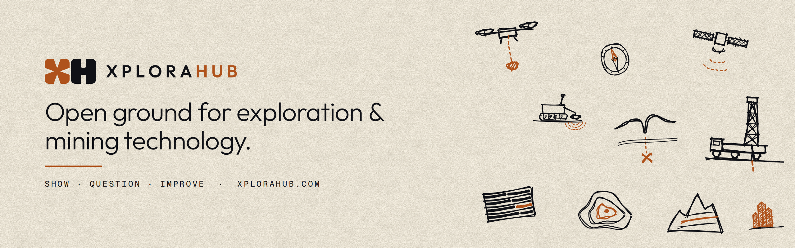

**[XploraHub](https://xplorahub.com)** is an online community for mineral exploration and mining technology. Members show the tools they build and the field tests they run, and geologists, geophysicists, engineers and data scientists question them in the open.

### How it works

| Show it | Question it | Improve it |
|---|---|---|
| Post a tool, model, dataset or field test, and say what it was tested on. | People who know the ground ask how it was tested and where it fails. | The author marks the comments that helped. Those hits build each member's expert profile. |

### Explore

- [**The feed**](https://xplorahub.com/feed): new tools, field tests and questions, ranked by members' votes
- [**Watch**](https://xplorahub.com/watch): exploration and mining videos worth watching, chosen for substance. Talks and case studies, tutorials and courses, and films of real field work, from societies, surveys, conferences and the companies building the technology. No investor promos.
- [**Experts**](https://xplorahub.com/directory) and [**technology companies**](https://xplorahub.com/directory/organisations): find the people who know a method, and the companies behind the tools
- [**Exploration methods**](https://xplorahub.com/methods): practical guides to geophysics, drilling, geostatistics and other methods used in exploration and mining

### A few words we use

- **Votes** rank posts. They only go up; there are no downvotes.
- **Hits** are comments the author marks because they improved the post or taught them something. Hits are earned, not given to yourself.
- **Endorsements** are members vouching for each other's expertise.
- **Verified** means XploraHub has checked a company is real and builds exploration or mining technology. **Official** marks a video from a listed company's own channel.

### Open source

- [**Awesome mineral exploration**](https://github.com/XploraHub/awesome-mineral-exploration): open-source software for exploration, sorted by method, from geophysical inversion to prospectivity mapping.
- Built an open-source tool for exploration? Add it to the list with a pull request, or [show it on XploraHub](https://xplorahub.com/submit).
